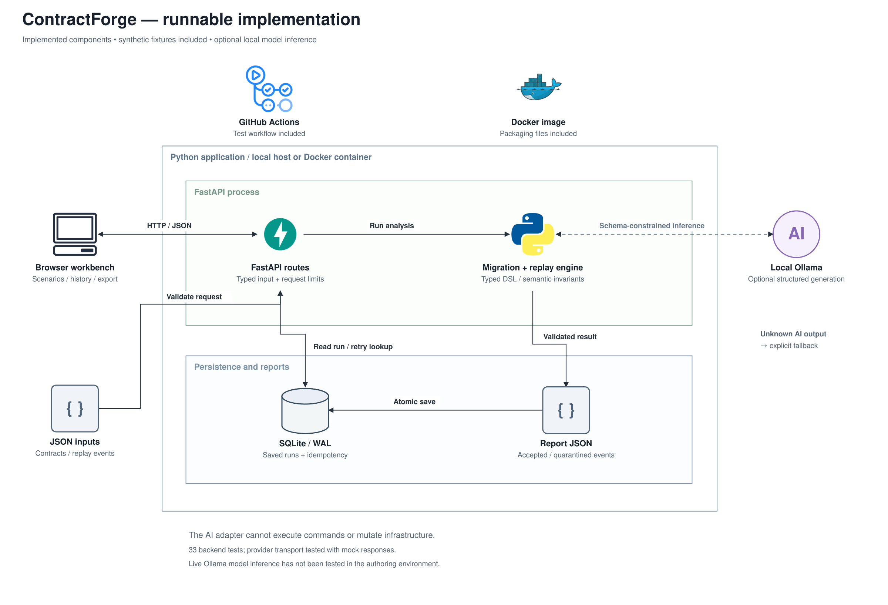

# ContractForge — low-level design

## Objective and non-goals

Given a source contract, target contract, and event sample, propose a bounded transformation and show which events survive. Keep every original, produce counterexamples, and compute an explicit sample-based gate. AI can propose the plan; replay determines the result.

Contracts use this project's small typed format, not the complete JSON Schema, Avro, or Protobuf specifications. Objects are flat at the declared-field level. Extra fields may carry JSON values but are not recursively schema-validated. The app does not register schemas, publish to Kafka, deploy migrations, or mutate production data.

[Editable implementation diagram](assets/implementation.drawio) · [Layered module view](assets/layers.png) · [Proposed AWS deployment](CLOUD_DESIGN.md)

## Domain contracts

| Model | Invariants |
| --- | --- |
| `FieldSpec` | Name, string/integer/number/boolean/timestamp type, required/nullable flags, optional aliases, string enum, semantic ID, cents/usd unit |
| `Contract` | 1–40 unique fields, unique non-null semantic IDs, version, optional identity field, explicit extra-field policy |
| `Plan` | Rationale and up to 80 typed operations; no executable code |
| `ReplayRequest` | Source/target, 1–1,000 events, optional user plan, rules/ollama mode, reject threshold in [0,1] |

Money units require numeric types and a semantic identity. Aliases must be unique and cannot equal the target field name. Multiple matching aliases are ambiguous and deliberately produce no inferred mapping. The identity field must exist in the contract; replay requires its value to be a non-null string or integer.

## Contract comparison

Prefer an exact source field name, then exactly one explicit alias. Classify required/optional additions, removals, renames, type changes, unit changes, tightened presence/nullability, narrowed string enums and extra-field policy. Diff flags potential breaking changes. It is deliberately conservative and does not attempt formal language-inclusion analysis.

## Restricted migration DSL

| Operation | Shape | Gate |
| --- | --- | --- |
| Rename | `{op:"rename", source, target}` | Existing source, declared unambiguous alias, unoccupied target |
| Cast | `{op:"cast", field, to}` | Declared target type; conversion must be unambiguous |
| Scale | `{op:"scale", field, factor}` | Factor is exactly `0.01` or `100` and must match declared cents/usd units |

The deterministic proposer emits rename, then scale, then cast for each matched target field. Unknown required fields are not invented; validation rejects events missing them. Default insertion, drop, arbitrary expressions, network access and generated code execution are absent by design.

AI receives both contracts and at most 20 example events. Its output is parsed as `Plan` and checked with the same `validate_plan` routine as a user-supplied plan. Invalid AI plans fall back to the deterministic proposal. An accepted plan can still fail event replay; plan validity is not migration safety.

## Replay algorithm

1. Reject non-JSON-finite values, including nested NaN or Infinity.
2. Validate the original event against the source contract. Invalid source records are quarantined without transformation.
3. Deep-copy the event. Apply operations in order. A missing source field is skipped so target presence rules decide the outcome; a rename that would overwrite an existing field is rejected.
4. Conversions reject boolean-as-number, fractional-to-integer, non-finite/out-of-range numbers, ambiguous boolean strings, naive timestamps, and object-to-string coercion. Decimal arithmetic checks unit conversions before writing a JSON number. Numeric magnitude is limited to 1e15. There is no claim of arbitrary-precision JSON float support.
5. Validate candidate fields against the target contract, including enums, nullability, required fields, and extra-field policy.
6. For each source semantic ID, find the target semantic ID and compare values. Money values are normalized to dollars with Decimal; other values use equality. Unmapped semantic values fail. This only protects semantics that were declared; it cannot infer business meaning from field names.
7. Check target identity uniqueness within this replay's accepted records. There is no cross-run or broker-wide deduplication claim.
8. Save original, candidate if produced, source-valid flag, errors and accepted/quarantined status. Transformation failures never erase the original.
9. Compute `reject_rate = quarantined / total` and pass only when it is at most `max_reject_rate` (default 0). A nonzero threshold can intentionally allow a pass with quarantined records; the UI shows both.

Target-valid is necessary but insufficient: semantic invariants can block a syntactically valid conversion that changes a business value. A gate passing a finite sample does not imply backward/forward compatibility for all possible events. Reports retain at most 10 highlighted counterexamples and every per-event result.

## Algorithmic limits

For N events, F fields and O operations, replay is approximately O(N(F+O)) plus copy/serialization cost. Plan validation operates on small bounded field sets. Memory stores the full request and report, bounded indirectly by the 2 MiB HTTP limit and 1,000-event maximum. CLI callers should also keep inputs small.

## Output contract

The report contains source and target schemas, planner identity, AI status/error, accepted plan, contract diff, all event outcomes, highlighted counterexamples and summary counts/gate/threshold. API persistence adds UUID and creation time and stores the canonical request digest separately. No action follows a passing gate automatically.

## Persistence model

One SQLite `reports` table stores `id TEXT PRIMARY KEY`, `idem_key TEXT UNIQUE NOT NULL`, `digest TEXT`, `created_at TEXT`, and serialized `payload TEXT`. `digest` is SHA-256 over sorted compact JSON of the Pydantic-normalized input. IDs are UUID4; timestamps are UTC. Each saved payload also carries the normalized request and its digest for reproducible inspection.

Every connection is explicitly closed. WAL is enabled at initialization. Writes use `BEGIN IMMEDIATE` and a 15-second SQLite busy timeout. The unique key is checked inside the write transaction. Requests with the same key and same input return the original saved record; differing input produces HTTP 409. The API exposes no update/delete operation. This is application immutability, not tamper-proof storage.

Analysis happens before the write lock. Two simultaneous identical requests can duplicate computation or model calls; only one report is persisted. Exactly-once model execution is not claimed. Stored reports have no retention job yet. A local operator owns the database and its backups.

## Model boundary

`llm.generate` makes one HTTP POST to the operator-configured `OLLAMA_URL` plus `/api/chat`. The caller cannot supply a provider URL in the request. `OLLAMA_MODEL` selects the model; `llama3.2` is the example default, not an automatically downloaded dependency.

The body includes a JSON response schema, `stream: false`, temperature 0, and a 1,600-token prediction budget. HTTP connect timeout is 3 seconds and read/write/pool timeout is 60 seconds. This is an inactivity timeout, not a hard wall-clock deadline. Response reading stops above 128,000 bytes. Redirects and environment proxy inheritance are disabled. Provider transport errors and malformed outputs produce an explicit fallback status.

The system prompt treats supplied content as untrusted data. This is not a proof of prompt-injection immunity. No tools, shell execution, SQL execution, or network actions requested by the model exist. User-visible model prose may still be wrong. The server logs no prompt or credential by design; SQLite persists the report evidence.

## API boundary and failures

| Condition | Behavior |
| --- | --- |
| Input body over 2 MiB, including chunked uploads | HTTP 413 |
| Invalid Pydantic request | HTTP 422 |
| `APP_TOKEN` configured, token absent or invalid | HTTP 401 on protected `/api/*` |
| Reused idempotency key for different normalized input | HTTP 409 |
| Missing scenario or saved report | HTTP 404 |
| Model unavailable / invalid output | HTTP 200 with evidence fallback and explicit `ai_status` |
| Unexpected runtime / database failure | Server error; never reported as a successful saved run |

The health route, static UI and OpenAPI schema remain public even with `APP_TOKEN`. No CORS middleware is enabled. The UI talks to the same origin and keeps its optional bearer token in page memory. Dynamic content is HTML-escaped. CSP restricts scripts and styles to the same origin and disallows framing.

The request-size limit does not cap request duration. This local service has no slow-client defense, rate limit, per-user authorization, background queue, cancellation endpoint, or retention controls. Bind to localhost as documented. Public hosting requires those additional boundaries and an authenticated reverse proxy.

## Deployment and operations

One Uvicorn process serves the application. The Docker image runs as UID 10001 and writes SQLite to `/data`; Compose mounts a named volume and binds the host port to 127.0.0.1. Ollama is a separate process reachable through an explicit endpoint. The model is optional and not bundled.

No Kubernetes, Kafka, Snowflake, Airflow, or managed-cloud resources are provisioned. The README's AWS blueprint is a separate, unimplemented deployment target; see [CLOUD_DESIGN.md](CLOUD_DESIGN.md) for the service mapping and required adapters. Production evolution would move long model calls into a durable queue, isolate workers, use PostgreSQL and object storage, add OIDC/authorization and telemetry, and define deletion/retention requirements before ingesting real logs.

## Complexity and operating limits

Payloads are bounded at 2 MiB. Model context is bounded further by domain selection; context-window fit still depends on the chosen model. Synchronous FastAPI handlers run through its thread-pool path; enough simultaneous model calls can saturate it. This release is for one developer and small replay/investigation batches, not a measured concurrency target.

## Source map

| File | Responsibility |
| --- | --- |
| `models.py` | Typed contracts and semantic input validation |
| `engine.py` | Pure domain analysis and model-output gate |
| `llm.py` | Ollama HTTP transport and resource budget |
| `store.py` | SQLite persistence and idempotency |
| `security.py` | Body limit, optional bearer guard, response headers |
| `api.py` | Routes, orchestration, error mapping, static mounting |
| `web/` | Browser workbench, JSON import/export, run history |
| `__main__.py` | Ephemeral command-line execution |
| `tests/` | Domain, HTTP API, persistence and provider contract checks |

See [VALIDATION.md](VALIDATION.md) for what was actually tested.
